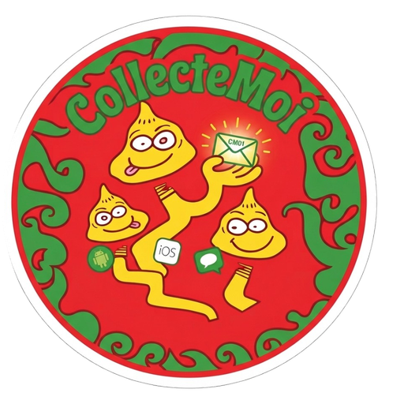
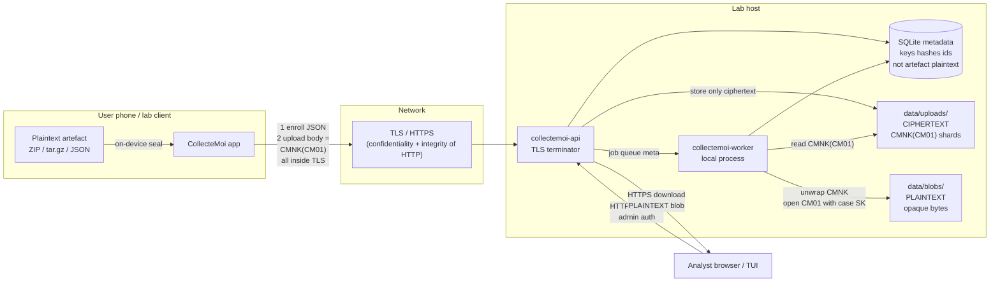
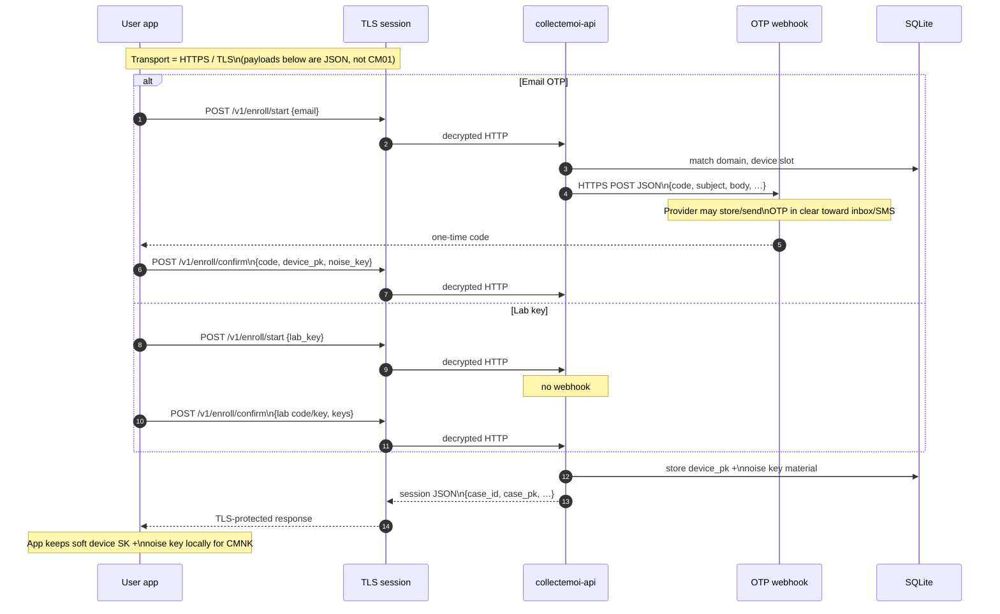
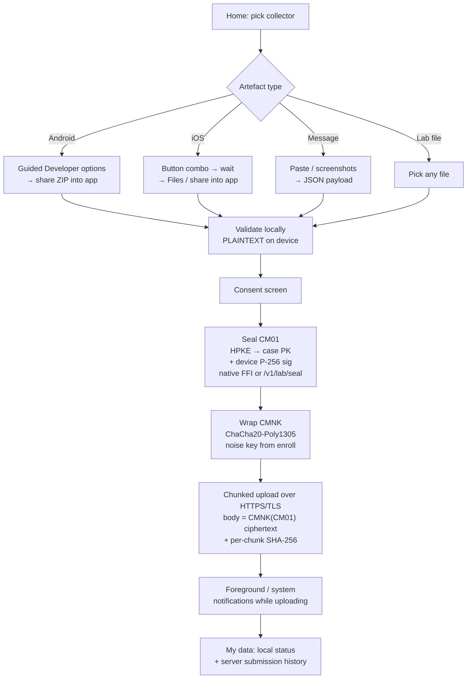
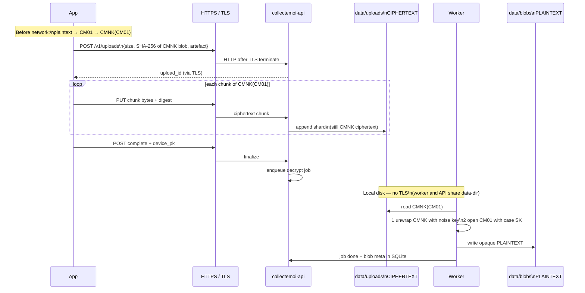
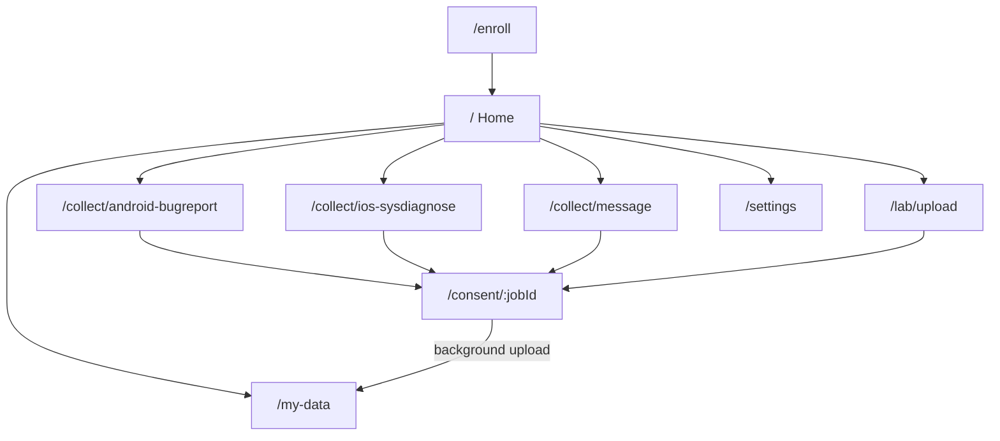
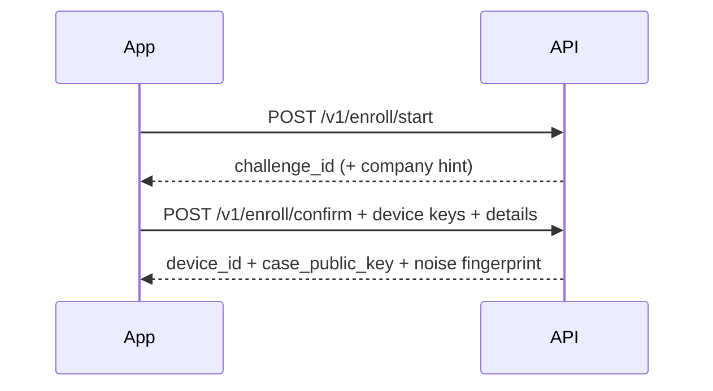
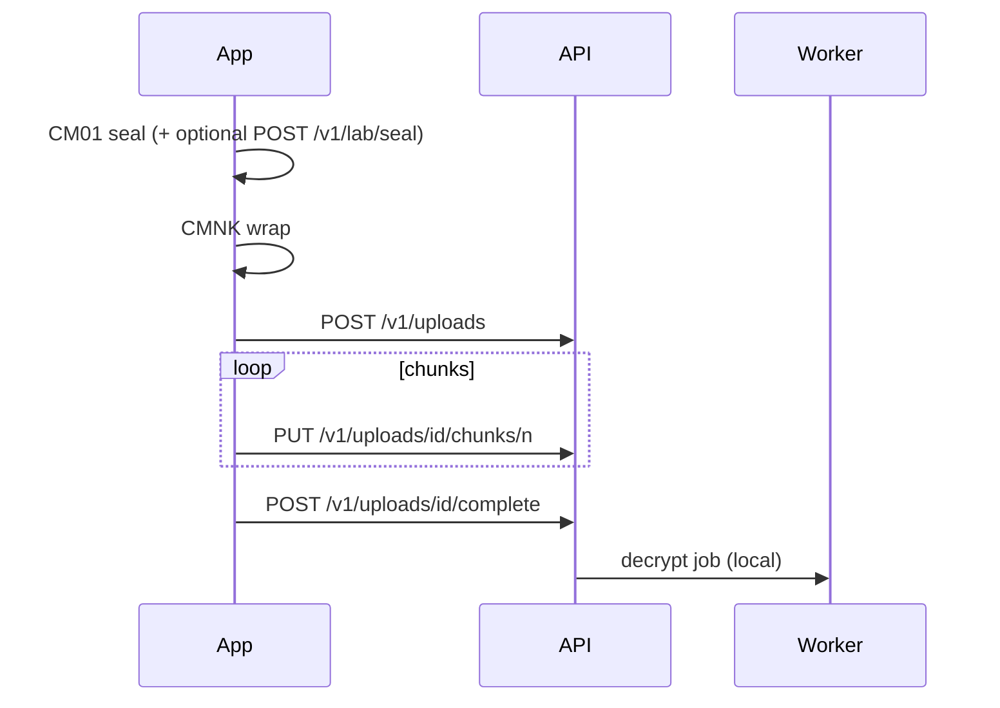
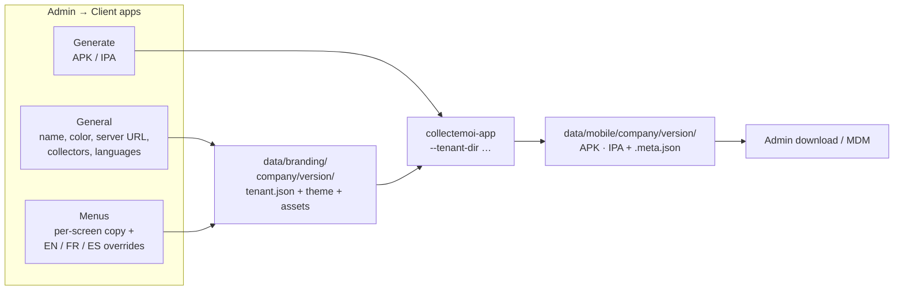
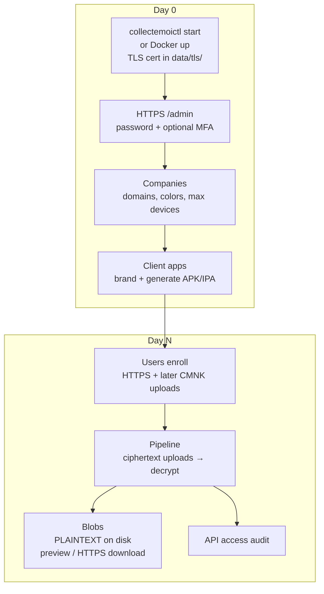

# CollecteMoi

<p align="center">
  
</p>

White-label Flutter app (Android, iOS, web lab) + Rust server that moves forensic artefacts — Android bugreport, iOS sysdiagnose, suspicious messages — from a phone to the lab, encrypted as **CM01** envelopes to the case key.

Deep design notes: [docs/ARCHITECTURE.md](docs/ARCHITECTURE.md).

---

## What it does

| Actor | Role |
| --- | --- |
| **Tenant / company** | Owns domains, branding, lab keys, and the server |
| **Analyst** | Runs the admin console, downloads decrypted blobs, builds branded apps |
| **User** | Enrolls a phone, follows a guided collector, consents, then leaves the upload to finish in the background |

**Artefacts collected today**

- **Android bugreport** — system ZIP via Developer options + share sheet  
- **iOS sysdiagnose** — hardware button combo + Files / share  
- **Suspicious message** — text, metadata, optional screenshots  

The server stores **opaque** decrypted blobs. It does not parse bugreports or sysdiagnoses.

---

## How it works

### Encryption layers (read this first)

Every network hop uses **TLS (HTTPS)** by default. Artefact bytes get two *application* layers on top of that:

| Layer | What it protects | Algorithm / keys | Who can open it |
| --- | --- | --- | --- |
| **TLS / HTTPS** | Wire traffic (enroll JSON, upload chunks, admin UI, webhook) | TLS 1.2+ (self-signed lab cert or your PEMs) | Anyone with the TLS session (API process sees HTTP after terminate) |
| **CM01** | Artefact plaintext end-to-end to the case | HPKE-X25519 + STREAM ChaCha20-Poly1305 + P-256 device signature | Holder of **case secret key** (`data/keys/case.sk.hex`) — the worker |
| **CMNK** | CM01 blob in transit / staging (per device) | ChaCha20-Poly1305 with the **noise key** from enroll | API/worker that stored that device’s noise key |

```text
plaintext artefact
    │  seal on device (or POST /v1/lab/seal for web)
    ▼
 CM01  ── encrypted to case public key ──► only case SK opens this
    │  wrap with device noise key
    ▼
 CMNK(CM01)
    │  send over HTTPS (TLS)
    ▼
 API writes ciphertext shards under data/uploads/
    │  worker: TLS not involved (local disk)
    ▼
 unwrap CMNK → open CM01 → plaintext under data/blobs/
```

**Important:** TLS stops at the API. Staging under `data/uploads/` is still **CMNK(CM01) ciphertext**. After the worker decrypts, `data/blobs/` holds **plaintext** (filesystem ACL / disk encryption are your responsibility). Admin downloads of blobs are plaintext again over **HTTPS + admin session**.

---

### Big picture



**Crypto boundaries**

1. **On device:** plaintext → **CM01** (to case public key) → wrap **CMNK** (device noise key). Web/desktop without FFI may call `POST /v1/lab/seal` (lab-only; plaintext briefly hits the API).  
2. **On the wire:** that ciphertext rides inside **TLS**.  
3. **On API disk (`uploads/`):** still **ciphered** as CMNK(CM01) until the worker runs.  
4. **After worker (`blobs/`):** **plaintext** opaque file; download is TLS-protected to the analyst, not re-sealed as CM01.

---

### Enrollment

Work email must match a **company domain**. Lab keys skip the mailbox (lab / demo only).  
All app ↔ API calls below are **HTTPS (TLS)**. The OTP code itself is **not** CM01 — it is sensitive JSON inside TLS (and then whatever your mail/SMS provider does).



**OTP notification text** is customized per company under **Client apps → Menus → Enroll** (`{code}`, `{company_name}`, `{display_name}`, `{email}`, `{expires_in_mins}`…). The API fills placeholders and sends `subject` / `body` on the webhook JSON.

**Defaults:** 6-digit code, 10 min TTL, `max_devices_per_email` = 1 (0 = unlimited). Re-enrolling the same device key for the same email is allowed. When `max_devices_per_email` is 1, wipe/reinstall (new keys) with the same email + OTP/lab key **rebinds** the existing device row instead of rejecting or creating a duplicate identity; the old public key is banned.

---

### Collect → consent → upload



**Upload protocol (all clients)**



**Upload notification copy** (encrypting / uploading / complete / failed) is branded under **Client apps → Menus → Upload notifications** and baked into the APK/IPA.

---

### App menus (Flutter) → server requests

All client routes talk to the API over **HTTPS (TLS)**. After enroll, almost every call also carries device identity headers (not a Bearer token):

| Header | Meaning |
| --- | --- |
| `x-device-id` | Enrolled device UUID |
| `x-app-version` | Flutter `version+build` |
| `x-device-platform` / `x-device-model` / `x-device-os` | Hardware / OS line |
| `x-device-manufacturer` / `x-device-brand` / `x-device-name` | Vendor / marketing name |
| `x-device-security-patch` / `x-device-api-level` / `x-device-build-id` | Android patch / API / build (when known) |



#### Enroll (`/enroll`)

| Step | Client action | Server |
| --- | --- | --- |
| 1 | User enters work email (or lab key) | `POST /v1/enroll/start` JSON `{ email }` or `{ lab_key }` |
| 2 | API matches company domain / lab key; OTP webhook if email | (TLS only; OTP is **not** CM01) |
| 3 | User enters code; app generates device P-256 key + noise key + device snapshot | `POST /v1/enroll/confirm` `{ challenge_id, code, device_public_key, noise_key, platform, model, os_version, manufacturer, brand, name, details, app_version }` |
| 4 | Session stored on phone | Response: `device_id`, `case_id`, `case_public_key`, `display_name`, `noise_key_fingerprint`, company fields |

Optional legacy: `POST /v1/enroll` with a one-shot token (same identity body).



#### Home (`/`)

| Step | Client action | Server |
| --- | --- | --- |
| Open / pull-to-refresh | Load open collection requests | `GET /v1/requests` |
| Health chip (toolbar) | Reachability | `GET /healthz` |
| Tiles | Navigate only (no upload yet) | — |

#### Settings (`/settings`)

| Step | Client action | Server |
| --- | --- | --- |
| Save server URL / open screen | Ping | `GET /healthz` |
| Theme, lab-key toggle, trust self-signed | Local prefs only | — |
| Clear enrollment (also from My data) | Wipe local session | — (lab data unchanged) |

#### Android bugreport (`/collect/android-bugreport`)

| Step | Client action | Server |
| --- | --- | --- |
| Guide + share / import ZIP | Validate locally; enqueue job + payload on disk | — |
| Continue | → Consent | — |

No HTTP until consent starts the upload.

#### iOS sysdiagnose (`/collect/ios-sysdiagnose`)

Same pattern as Android: local capture / Files import → enqueue → Consent. No HTTP until upload.

#### Suspicious message (`/collect/message`)

| Step | Client action | Server |
| --- | --- | --- |
| Compose channel / sender / body / screenshots | Build JSON payload (+ optional base64 images); enqueue with summary | — |
| Continue | → Consent | — |

`POST /v1/messages` exists as a stub; the real path is the CM01 upload below.

#### Lab file upload (`/lab/upload`)

Lab-only tile: pick any file → enqueue → Consent (same upload pipeline).

#### Consent (`/consent/:jobId`)

| Step | Client action | Server |
| --- | --- | --- |
| User checks consent | Starts background encrypt/upload; UI goes to My data | — |
| Seal | On-device CM01 (native FFI) **or** lab fallback | Optional `POST /v1/lab/seal` (web / missing FFI; plaintext briefly on API) |
| Wrap | CMNK with enroll noise key | — |
| Upload | Chunked ciphertext | See table below |

| Upload request | Method / path | Body |
| --- | --- | --- |
| Create | `POST /v1/uploads` | `{ case_id, artefact, total_size, chunk_size, chunk_count, ciphertext_sha256 }` |
| Chunk | `PUT /v1/uploads/{id}/chunks/{n}` | raw bytes + `Digest: sha-256=…` |
| Finish | `POST /v1/uploads/{id}/complete` | `{ device_public_key }` → API unwraps CMNK, verifies CM01, queues worker |

Banned devices get `403` `{ "error": "device_banned" }` on create / chunk / complete.

Per-device flood control is **server-only** (the app does not self-throttle). Each company has `device_uploads_per_hour` (default **10**, `0` = unlimited). `POST /v1/uploads` returns `429` `{ "error": "device_rate_limited" }` when the device exceeds that company quota in the rolling window (`--rate-limit-device-window-secs`, default 1 hour). Chunk PUTs are not counted. Admins can set **Bypass quota** on a device to ignore the company limit.



#### My data (`/my-data`)

| Step | Client action | Server |
| --- | --- | --- |
| Open / refresh history | List what the lab holds for this device | `POST /v1/client/submissions` body = CMNK proof of `collectemoi-client-submissions-v1:{device_id}` |
| Failed list | Resend / Delete (local payload) | Resend = same upload sequence as Consent |
| Device card | Shows enroll snapshot (+ patch/API from later headers) | Headers on any call update `last_seen` / details |
| Health chip (default 60s; Admin → Settings) | `GET /healthz` with `x-device-id` (+ hardware headers) | Touches device `last_seen` (no access_log row). Response header `x-collectemoi-healthz-interval` sets the next poll period |

#### Headers refresh (any enrolled call)

Whenever the app hits the API after boot — including the toolbar `/healthz` poll — it re-captures device info and sends the `x-device-*` headers above. The API updates `last_seen` and may merge `security_patch` / `api_level` / `build_id` into the device row (admin Devices view).

---

### White-label client apps

Analysts brand and build apps from **Admin → Client apps** without changing Flutter source by hand.



**Languages**

- **General → App languages**: choose which of `en` / `fr` / `es` the build supports, plus default locale.  
- **Menus**: English is the base; Français / Español tabs store overrides (`copy_i18n`, `strings_i18n`).  
- Blank overrides → built-in dictionary lookup of the English string → English.  
- Custom English text that is not in the dictionary will not auto-translate unless you fill FR/ES overrides.

---

### Admin & ops workflows

Admin UI and TUI talk to the API over **HTTPS (TLS)** with an **HttpOnly cookie session** (+ optional TOTP / WebAuthn). Blob downloads are **plaintext artefact bytes** inside that TLS session (not CM01 again).



| Area | What you do |
| --- | --- |
| **Overview** | Health, KPIs, bandwidth, attention |
| **Pipeline** | Incomplete uploads, decrypt jobs |
| **Blobs** | Metadata, download, delete; **message reports** show text + screenshot gallery |
| **Devices** | Ban / unban; related blobs; **last check-in** from `/healthz` / API (`online` ≈ 2× healthz poll interval) |
| **Companies** | Domains, lab keys, tokens, pause enroll |
| **Client apps** | Branding versions, languages, generate/stop builds |
| **Settings** | Public URL, lab seal, CMDEV, **healthz poll** (15–3600s, default 60), OTP webhook, backup |
| **Security** | Password, TOTP, WebAuthn |
| **TUI** | `./scripts/collectemoictl tui` — same cookie login |

---

## Status

| Milestone | Status |
| --- | --- |
| Envelope + chunked upload + CLI | Done (`CM01` + `CMNK`) |
| On-device / lab CM01 seal | Done (native FFI + `/v1/lab/seal` for web) |
| Android / iOS / message collectors | Done (guided flows + validation) |
| Lab admin console + process ctl | Done (`/admin`, TUI, `collectemoictl`) |
| White-label branding + APK/IPA | Done (multi-version, i18n, notifications) |
| Node/TS desktop client | Done (`clients/node`) |
| Analyst case workflows / parsers / Postgres | Spec / next — see architecture doc |

---

## Quick lab (API + worker)

```bash
export PATH="/opt/homebrew/share/flutter/bin:$PATH"   # if needed

./scripts/collectemoictl start
./scripts/collectemoictl status
./scripts/collectemoictl health
./scripts/collectemoictl doctor
./scripts/collectemoictl logs -f
# ./scripts/collectemoictl restart --bind 0.0.0.0:8080 --public-url https://192.168.1.10:8080
# ./scripts/collectemoictl start --tls-cert ./fullchain.pem --tls-key ./privkey.pem
# ./scripts/collectemoictl start --http-bind 127.0.0.1:8081   # optional plain HTTP
# ./scripts/collectemoictl stop

# Forgot admin password (host-local):
# ./scripts/collectemoictl reset-password
# ./scripts/collectemoictl reset-password --keep-mfa --yes
```

Or manually:

```bash
cargo build -p collectemoi-envelope
cargo run -p collectemoi-api -- \
  --data-dir ./data \
  --bind 127.0.0.1:8080 \
  --public-url https://127.0.0.1:8080 \
  --lab-seal true
cargo run -p collectemoi-worker -- --data-dir ./data
```

**Admin:** [https://127.0.0.1:8080/admin](https://127.0.0.1:8080/admin) (trust or proceed past the self-signed cert under `data/tls/`).

**Admin TUI:**

```bash
./scripts/collectemoictl tui
```

**TLS:** HTTPS by default. Missing certs → auto self-signed in `data/tls/`. Plain HTTP only with `--http-bind` or `--tls false`.

---

## Docker

One image: **API + worker + Flutter/Android toolchain** (admin can generate branded APKs). Data lives in volume `collectemoi-data` → `/data`.

```bash
./scripts/collectemoi-docker                 # build collectemoi:local (prefer linux/amd64 on Apple Silicon)
./scripts/collectemoi-docker up              # https://127.0.0.1:8080/admin  ·  http://127.0.0.1:8081/healthz
./scripts/collectemoi-docker update --version 1.4.1 -d
./scripts/collectemoi-docker load dist/collectemoi-1.4.1.tar.gz
./scripts/collectemoi-docker run             # single container (api+worker)
./scripts/collectemoi-docker wipe-data --yes # intentional clean slate only
```

```bash
cp .env.example .env   # COLLECTEMOI_PUBLIC_URL, OTP webhook, ports…
```

Image roles: `api` (default), `worker`, `all`. Give the API container ≈8 GB+ RAM for the first Gradle/APK build.

### Package and VPS push

```bash
./scripts/collectemoictl package --platform linux/amd64 --version 1.4.0
./scripts/collectemoictl push deploy@example.com --public-url https://example.com:8080
```

`push` loads the image over SSH and starts test API/worker containers on volume `collectemoi-test-data`. Public binds do **not** seed demo companies / `LAB-*` keys — create them in admin. Flutter trusts self-signed TLS only for loopback; remote labs need a trusted cert (Node has `--insecure` for lab only).

---

## Clients

### Flutter (`app/`)

```bash
cd app && flutter run -d chrome   # or a device
./scripts/collectemoi-app doctor
./scripts/collectemoi-app apk --server https://192.168.1.10:8080 --install
./scripts/collectemoi-app ios --simulator
```

1. Enroll (email OTP, lab key, or QR).  
2. Collect → consent → background upload.  
3. Worker writes an opaque blob under `data/blobs/`.

Bake server URL with `--server` / `--dart-define=COLLECTEMOI_SERVER_URL=…`, or set it on the enroll screen. Bind the API for LAN phones:

```bash
./scripts/collectemoictl start --bind 0.0.0.0:8080 --public-url https://192.168.1.10:8080
```

iOS Share Extension notes: [`app/ios/ShareExtension/README.md`](app/ios/ShareExtension/README.md).

### Node / TypeScript (`clients/node/`)

```bash
./scripts/collectemoi-client-ui --insecure
# → http://127.0.0.1:8090/

cd clients/node && npm install
npx tsx src/cli.ts enroll --server https://127.0.0.1:8080 --lab-key LAB-DEMO01 --insecure
npx tsx src/cli.ts collect --file ~/Desktop/sample.zip --artefact android_bugreport --insecure
```

See [clients/node/README.md](clients/node/README.md).

### Rust CLI

```bash
cargo run -p collectemoi-cli -- gen-case-key --out /tmp/case
cargo run -p collectemoi-cli -- gen-device-key --out /tmp/device
cargo run -p collectemoi-cli -- upload --input file.zip \
  --server https://127.0.0.1:8080 \
  --case-id 00000000-0000-4000-8000-000000000001 \
  --case-pk /tmp/case.pk --device-sk /tmp/device.sk
```

**CM01 sealing:** native FFI (`libcollectemoi_envelope`) when present; otherwise `POST /v1/lab/seal` (disable with `--lab-seal false` outside lab). Case keys: `data/keys/case.{pk,sk}.hex`.

---

## Configuration

Primary knobs are **CLI flags** (and Admin → Settings). A few deploy helpers also accept env (OTP webhook, Docker `.env`).

### `collectemoi-api`

| Flag | Default | Meaning |
| --- | --- | --- |
| `--data-dir` | `./data` | Uploads, keys, jobs, DB |
| `--bind` | `127.0.0.1:8080` | Listen address |
| `--public-url` | `https://127.0.0.1:8080` | Advertised URL |
| `--tls` | `true` | HTTPS; auto `data/tls/server.{crt,key}` |
| `--tls-cert` / `--tls-key` | under `data/tls/` | Custom PEMs |
| `--http-bind` | `off` | Optional plain HTTP companion |
| `--lab-seal` | `true` | `POST /v1/lab/seal` for web |
| `--lab-reveal-otp` | `false` | Include OTP in start response (dev only) |
| `--otp-delivery-webhook-url` | empty | Also `COLLECTEMOI_OTP_WEBHOOK_URL` |
| `--otp-delivery-webhook-token` | empty | Also `COLLECTEMOI_OTP_WEBHOOK_TOKEN` |
| `--allow-dev-envelope` | `false` | Accept legacy `CMDEV` |
| `--rate-limit` | `true` | Per-IP limits + cool-down |
| `--max-concurrent` | `1024` | In-flight HTTP cap |
| `--db-pool-size` | `0` (auto) | SQLite connection pool |
| `--request-timeout-secs` | `300` | Per-request timeout |
| `--rate-limit-upload` | `3000` | Chunk PUTs / IP / minute |
| `--rate-limit-device-uploads` | `10` | Fallback quota when a device has no company |
| `--rate-limit-device-window-secs` | `3600` | Window for the per-device upload quota |
| `--case-pk` / `--case-sk` | `data/keys/…` | Optional case key paths |
| `--log` | `collectemoi_api=info` | Tracing filter |

### `collectemoi-worker`

| Flag | Default | Meaning |
| --- | --- | --- |
| `--data-dir` | `./data` | Same tree as API |
| `--poll-secs` | `1` | Idle poll interval (busy queue polls ~50 ms) |
| `--workers` | `0` (auto) | Parallel decrypt jobs (8–32 from CPUs) |
| `--db-pool-size` | `0` (auto) | SQLite connection pool |
| `--case-pk` / `--case-sk` | `data/keys/…` | Optional case key paths |
| `--log` | `collectemoi_worker=info` | Tracing filter |

### Capacity (many devices / parallel uploads)

Thousands of **enrolled** devices are fine (SQLite rows). Thousands **uploading large artefacts at once** need disk I/O and these knobs:

| Concern | What to tune |
| --- | --- |
| In-flight HTTP | `--max-concurrent` (default 1024) |
| SQLite writers | `--db-pool-size` on API **and** worker (WAL + pool; auto ≈ 4× CPUs) |
| Decrypt backlog | worker `--workers` (auto 8–32); keep API+worker on fast local disk for `data/` |
| Shared NAT / office Wi‑Fi | `--rate-limit-upload` (chunk PUTs per IP per minute) |
| One device flooding reports | Company **Uploads / device / hour** (admin); optional per-device **Bypass quota** |
| Disk | Size `data/uploads` + `data/blobs` for peak concurrent ciphertext + plaintext |

Chunk PUTs update a single SQLite bit (no full-row rewrite / no per-chunk `meta.json`). The worker claims jobs in batches and keeps worker slots filled instead of waiting for a whole batch to finish before the next poll.

Still a **single-node SQLite** design — for multi-region / SaaS-scale catalogue writes, the roadmap is Postgres ([docs/ARCHITECTURE.md](docs/ARCHITECTURE.md)).

### Useful HTTP surfaces

| Method | Path | Meaning |
| --- | --- | --- |
| `GET` | `/healthz` | Liveness |
| `GET` | `/admin` | Admin console |
| `POST` | `/v1/enroll/start` · `/confirm` | Enrollment |
| `POST` | `/v1/uploads` · chunks · complete | Chunked upload |
| `POST` | `/v1/lab/seal` | Lab-only CM01 seal |
| `GET` | `/v1/admin/blobs…` | List / meta / content / delete |
| `GET` | `/v1/admin/access-stats` · `access-log` | API audit |
| `POST` | `/v1/client/submissions` | Device submission history (noise proof) |

**Backup:**

```bash
./scripts/collectemoictl export --out ./backup.zip --keys
./scripts/collectemoictl import ./backup.zip --force --keys
# or Admin → Settings → Backup
```

**Process ctl:** `start` / `stop` / `restart` / `status` / `health` / `doctor` / `logs` / `open` / `tui` / `version` / `reset-password` / `export` / `import` / `package` / `push`.

---

## Layout

```text
crates/collectemoi-envelope/   # CM01 + C FFI
crates/collectemoi-db/         # SQLite catalogue
crates/collectemoi-api/        # enroll, uploads, lab seal, /admin
crates/collectemoi-worker/     # decrypt → opaque blobs
crates/collectemoi-cli/
crates/collectemoi-tui/
clients/node/
scripts/collectemoictl
scripts/collectemoi-docker
scripts/collectemoi-client-ui
scripts/collectemoi-app
app/                           # Flutter
docs/ARCHITECTURE.md
data/collectemoi.db
data/keys/  data/tls/  data/uploads/  data/blobs/
data/branding/                 # per-company tenant bundles
data/mobile/                   # generated APK/IPA
data/run/                      # ctl PID + logs
```

---

## Tests

```bash
cargo test --workspace
cargo test -p collectemoi-envelope regenerate_golden_envelope -- --ignored

cd app && flutter test && flutter analyze
```

---

## Lab limits (intentional)

- Open collection requests are still demo-oriented — not full analyst-authored case workflows  
- Worker stores opaque blobs only (no real bugreport/sysdiagnose analysers)  
- `POST /v1/messages` is a stub; the Flutter message collector uses the CM01 upload path  
- App-layer rate limits are not a substitute for edge DDoS protection  
- Single-node SQLite catalogue (pooled WAL) — not multi-writer Postgres yet  
- Roadmap (Postgres, DPoP, OIDC, KMS, crypto-shred UI): [docs/ARCHITECTURE.md](docs/ARCHITECTURE.md)
