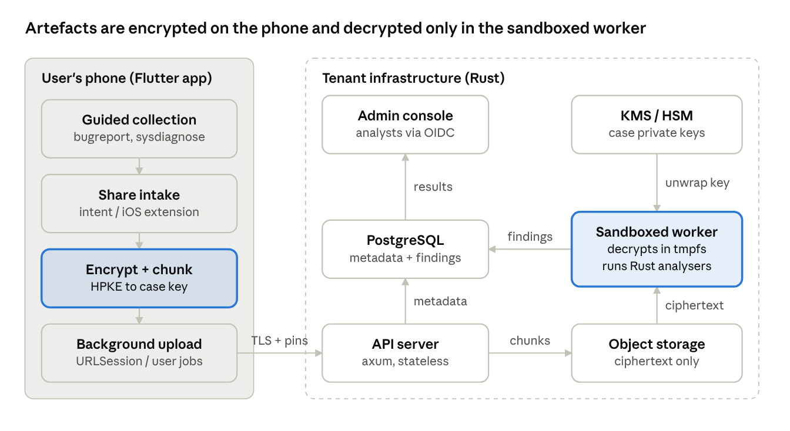

# CollecteMoi — Architecture Spec

Oct 30, 2026 · Anthony

## Overview

CollecteMoi is a white-label Flutter app (Android + iOS) and a Rust server. Together they get forensic artefacts from a user's phone to an analyst without asking the user to understand ADB, file systems or encryption. The app guides the user through the manual steps neither OS lets an app skip, then encrypts, uploads and resumes in the background.

**What it collects**

- **Android bugreport**: a ZIP produced by the system dumpstate, started by the user from Developer options.
- **iOS sysdiagnose**: a `.tar.gz` produced by a hardware button combo and picked up from Analytics Data.
- **Suspicious messages**: shared from the messaging app, picked as screenshots, or pasted by hand with metadata.

**Actors**

- *Tenant*: the organisation running a deployment (CERT, NGO, company SOC). It owns the branding, the server and the cases.
- *Analyst*: the tenant staff member who creates collection requests and reads the results.
- *User*: the phone owner. They may be non-technical and may be using a compromised device.

**Goals**

- A non-technical user produces a valid bugreport or sysdiagnose in under 15 minutes of their own time.
- Uploads survive app kills, network loss and reboots, with no user action after consent.
- A new tenant can be rebranded without code changes.
- The server never sees plaintext unless the tenant's analysis workers are allowed to decrypt.

**Non-goals for v1**

- Silent or covert collection. Every collection is user-initiated and consented.
- On-device analysis. The app collects and transports; analysis runs server-side.
- Reading SMS, iMessage or WhatsApp stores directly. Neither OS allows it for a third-party app.



The two highlighted boxes are the crypto boundaries: the API server, the database and object storage never hold plaintext.

## White-label configuration

I recommend two distribution modes from one codebase. The launcher icon and app name can only change at build time. Everything else can change at runtime.

| Mode | How a tenant gets it | Icon and app name | Best for |
| --- | --- | --- | --- |
| Dedicated build | CI produces a signed app per tenant, with its own bundle ID and store listing | Tenant's own | Large customers, MDM-distributed enterprise apps |
| Generic app | Store app "CollecteMoi"; scanning an enrollment QR pulls the tenant's branding | CollecteMoi | Small tenants, one-off investigations |

**Tenant bundle** (`tenant/<id>/`), shared by both modes:

- `tenant.json`: display name, server base URL, TLS pin set (SPKI SHA-256), tenant encryption public key, enabled collectors, support contact, privacy-policy URL, default locale.
- `theme.json`: Material 3 seed colour, light and dark overrides, typography.
- `assets/`: logo (SVG + PNG), splash, launcher icons (dedicated build only).
- `l10n/*.arb`: string overrides on top of the base translations, including the guide texts.
- `guides/`: per-OS step images or animations, so a tenant can localise screenshots.

**Build side**: Flutter flavors plus a generator script (or `flutter_flavorizr`) that writes `applicationId`, `PRODUCT_BUNDLE_IDENTIFIER`, the App Group ID, icons and signing config from `tenant.json`. The iOS share extension and the App Group must be re-identified per tenant, so this is scripted, not manual.

**Runtime side**: after enrollment, the server serves the same bundle as a signed manifest (`GET /v1/tenant/manifest`, Ed25519 signature checked against a key pinned in the build). Signing stops a network attacker from swapping the server URL or the encryption key. A dedicated build trusts only its baked-in tenant; the generic app pins a CollecteMoi root key that signs tenant manifests.

## Android bugreport collection

The app cannot start a bugreport itself: `dumpstate` needs the shell or system UID. So the app guides the user through Developer options, then *receives* the finished report through the system share sheet. That makes CollecteMoi the share target, so the user never has to find the file.

**Guided flow**

1. **Check state.** Read `Settings.Global.DEVELOPMENT_SETTINGS_ENABLED`. If it is already on, skip to step 3.
2. **Enable Developer options.** Deep-link to `Settings.ACTION_DEVICE_INFO_SETTINGS` and show an OEM-specific animation of where "Build number" lives (Pixel, Samsung, Xiaomi and others differ). The user taps it 7 times. The app polls the setting on resume and moves on automatically.
3. **Start the report.** Deep-link to `Settings.ACTION_APPLICATION_DEVELOPMENT_SETTINGS` and point the user to "Take bug report". Recommend **Full report**, because Interactive drops some sections.
4. **Wait.** Generation takes about 2 to 10 minutes. The app shows a timer and explains that the system notification will turn into "Bug report captured".
5. **Share.** The user taps the notification, accepts the system privacy warning, and picks CollecteMoi in the share sheet.
6. **Validate and consent.** The app checks the file (below), shows its size and capture time, and asks for explicit consent before queueing the upload.
7. **Optional clean-up.** Offer to switch Developer options back off.

**Receiving the file**

- Declare an activity with intent filters for `ACTION_SEND` and `ACTION_SEND_MULTIPLE` on MIME `application/vnd.android.bugreport` (what AOSP's Shell app sends), with `application/zip` as a fallback for OEM variants.
- Copy the `content://` stream straight into app-private storage. Never load it into memory: reports run from 20 MB to over 200 MB.
- In Flutter, a small native `MethodChannel` handler is more reliable than generic share plugins for large `SEND_MULTIPLE` payloads.

**Validation before upload**

- The ZIP opens and contains `main_entry.txt`, plus the `bugreport-*.txt` it names.
- The `dumpstate` header timestamp is recent (configurable, default under 24 hours), so a stale report is not sent by mistake.
- The header's build fingerprint matches `Build.FINGERPRINT`, so a report from another device is flagged.

**Edge cases**

- MDM policy can block Developer options. Detect this and offer the desktop fallback: a WebADB page run by the tenant that calls `adb bugreport` over WebUSB.
- Samsung `*#9900#` SysDump and other OEM dumps are out of scope for v1.

## iOS sysdiagnose collection

iOS gives an app no way to trigger a sysdiagnose, no deep link to Analytics Data, and no way to detect that one has started. `App-prefs:` URLs are private API and get rejected at App Review. So the flow relies on clear visuals, then has the user share the archive into the app's share extension, with "Save to Files" plus an in-app picker as the fallback.

**Guided flow**

1. **Prepare.** Ask the user to unlock the phone, connect to Wi-Fi and charge above 30%. Generation is heavy on CPU and storage.
2. **Trigger.** An animation shows the model-specific combo: press and hold *both volume buttons + side button* for about 1 to 1.5 seconds and release on the short vibration. A screenshot flash means the hold was too short or too long. Older Home-button models use a different combo, keyed off `utsname.machine`.
3. **Wait about 10 minutes.** The app starts a local timer notification. It cannot see progress, so it says so honestly.
4. **Find the file.** Step-by-step images walk the user to Settings → Privacy & Security → Analytics & Improvements → Analytics Data, then to the newest `sysdiagnose_YYYY.MM.DD_HH-MM-SS…tar.gz`.
5. **Share.** The user taps the file, then the Share button, then CollecteMoi.
6. **Validate and consent**, then queue the upload, same as Android.

**Share extension design**

- A native Swift share extension (Flutter does not run in extensions) accepts `public.data` / `org.gnu.gnu-zip-archive` with a name matching `sysdiagnose_*`, plus text and images for messages.
- Archives are often 200 MB to over 1 GB, and extensions have a tight memory ceiling. The extension only stream-copies the file into the **App Group** container using `NSFileCoordinator`, writes a small job record, and finishes.
- The main app picks up the job on next launch. The extension can also start a background `URLSession` that shares the App Group container, so the upload begins even if the user never reopens the app.

**Fallback path**: "Save to Files" from the share sheet, then "Import from Files" in the app (`UIDocumentPickerViewController` with `asCopy: true`).

**Validation before upload**

- The file name matches the sysdiagnose pattern, and the embedded date is recent.
- The gzip header is valid and the tar listing shows the top-level `sysdiagnose_*/` folder and `logs/`. Read headers only; don't extract.
- The device model and build in the file name match the running device, or the mismatch is flagged.

**To verify on target iOS versions**: whether sysdiagnose archives show in Analytics Data when "Share iPhone Analytics" is off, and the exact share-sheet UTI on iOS 18 and 26.

## Suspicious message collection

Three intake paths all feed one `MessageReport`. Each path captures what the OS hands over, and the user fills in what it doesn't.

| Path | Android | iOS | What arrives | What the user adds |
| --- | --- | --- | --- | --- |
| Share from the messaging app | `ACTION_SEND` with `text/plain` and `image/*` | Share extension, same as for sysdiagnose | Message text or link; sometimes a forwarded image | Sender, channel, date received |
| Screenshots | Android Photo Picker (no storage permission) | `PHPickerViewController` (no library permission) | 1 to N images with EXIF time | Sender, channel, optional transcription |
| Manual paste | Text field with clipboard paste | Same | Raw text | All metadata |

**`MessageReport` fields**

- `channel`: SMS, RCS, iMessage, WhatsApp, Signal, Telegram, email, social DM, other.
- `sender`: free text (number, handle or address), normalised server-side to E.164 where possible.
- `received_at`: user-entered and optional, plus `reported_at` set by the app.
- `body_text`, `attachments[]`: images as received; the original bytes are kept and never re-encoded.
- `user_note`: why it looks suspicious ("asked me to install an app", "link to a fake parcel site").
- `clicked_link` and `replied` flags, which help triage.

**Client-side helpers**

- Pull out URLs and phone numbers as the user types, so they can confirm the parsed link.
- Never open or fetch the URL on the device. A link may be a one-click exploit or a tracking beacon.

**Server-side follow-ups** (see Analysis pipeline): OCR on screenshots, URL and domain extraction, IOC matching, and optional sandboxed URL detonation by the tenant.

## Authentication and device enrollment

The user should never type a password. They enroll once by scanning a QR code or opening a link, and from then on the device authenticates itself with a hardware-backed key. That is what makes background uploads invisible to the user.

**Enrollment**

1. An analyst creates a *collection request* (case + requested artefacts) in the admin console. The server mints a one-time enrollment token: 128-bit, 72-hour TTL by default, single use.
2. The token travels as a QR code or a universal/app link: `https://<tenant-host>/e/<token>`. A short 8-character code typed by hand is the fallback for phone or in-person support.
3. The app makes a P-256 key pair in the Secure Enclave (iOS) or StrongBox/TEE Keystore (Android), not exportable.
4. `POST /v1/enroll` sends the token, public key, platform, model and OS version, plus attestation where available: Android Key Attestation chain or Play Integrity token; iOS App Attest assertion.
5. The server checks the token, records the device, binds it to the case and returns `device_id` plus the signed tenant manifest.

**Request authentication**

- Short-lived access tokens (15 minutes) from `POST /v1/token`, with a signed server challenge. No long-lived bearer secret is stored on the device.
- Each request carries a DPoP-style proof (RFC 9449) signed by the device key, so a stolen token is useless without the key.
- TLS 1.3 with SPKI pinning from the manifest; pins rotate through the signed manifest.

**Attestation policy** is per tenant: *off*, *log only* (default; a compromised or rooted phone is often exactly the one under investigation) or *enforce*.

**Enterprise option**: tenants with an IdP can require OIDC (AppAuth, PKCE) at enrollment, to tie the device to an employee identity. Later requests still use the device key.

**Revocation**: an analyst can revoke a device or close a case. The next token request fails, and the app wipes queued data for that case.

## Secure background upload

Every artefact is encrypted on the device to the case's public key, cut into fixed-size encrypted chunk files, and uploaded chunk by chunk through the OS background transfer service. A dropped connection costs at most one chunk. A killed app or a reboot costs nothing.

**Encryption (payload layer, on top of TLS)**

- Per artefact: a random 256-bit file key, wrapped with HPKE (RFC 9180, DHKEM-X25519 / HKDF-SHA256 / ChaCha20-Poly1305) to the **case** public key from the manifest.
- The payload is encrypted as an age-style STREAM: 64 KiB segments, ChaCha20-Poly1305, a counter nonce, and a last-segment flag, so truncation and reordering are detected.
- The header (wrapped key, artefact type, original size, plaintext SHA-256) is signed by the device key, which proves which enrolled device produced it.
- A shared Rust crate (`collectemoi-envelope`) implements this. It compiles to the app through `flutter_rust_bridge` and to the server natively, so both sides run one implementation.

**Chunked, resumable protocol**

1. `POST /v1/uploads`: artefact type, case ID, total size, chunk size (8 MiB default), chunk count, ciphertext SHA-256 → `upload_id`.
2. `PUT /v1/uploads/{id}/chunks/{n}`: body is one chunk file; the `Digest` header carries its SHA-256. The call is idempotent, so re-sending a chunk is safe.
3. `GET /v1/uploads/{id}`: bitmap of the chunks received, used to resume after any failure.
4. `POST /v1/uploads/{id}/complete`: the server checks the whole-file hash and the envelope signature, then queues analysis.

**Background execution**

| Platform | Mechanism | Notes |
| --- | --- | --- |
| iOS | Background `URLSession` with `uploadTask(with:fromFile:)` | Runs while the app is suspended or killed; only file-based uploads are allowed, which is why chunks are written to disk first. Its identifier is shared with the App Group so the share extension can start it. |
| Android 14+ | User-initiated data transfer job (`JobInfo.Builder.setUserInitiated(true)`) | Made for large transfers the user started; shows a progress notification; survives Doze. |
| Android 8 to 13 | `WorkManager` with network constraint, plus an expedited foreground worker (`dataSync` type) | Retries with exponential backoff. |

On the Flutter side, `background_downloader` already wraps both mechanisms for file uploads. Wrap it behind an `UploadQueue` interface so it can be replaced by native code if it falls short.

**Local data hygiene**

- The plaintext copy is deleted as soon as encryption succeeds. Ciphertext chunks are deleted when the server acknowledges `complete`.
- Local files use `NSFileProtectionCompleteUntilFirstUserAuthentication` on iOS so uploads can run while the phone is locked, and app-private storage on Android.
- Queue state lives in a small SQLite DB (`drift`), so the UI shows honest progress and resumes after app restarts.

## Rust server architecture and API

One Cargo workspace, three binaries, all on Tokio. The API server stays thin and stateless, so analysis load never slows uploads.

| Crate / binary | Role | Main dependencies |
| --- | --- | --- |
| `collectemoi-api` | Device API, admin API, upload ingestion | `axum`, `tower` (rate limit, timeouts), `sqlx` |
| `collectemoi-worker` | Validation, decryption (when allowed), dispatch to analysers | Job queue on Postgres (`SKIP LOCKED`, or `apalis`) |
| `collectemoi-admin` | Analyst web console (or an SPA served by the API) | OIDC login for analysts |
| `collectemoi-envelope` (lib) | Encryption format, shared with the app | `hpke`, `chacha20poly1305`, `p256` |
| `collectemoi-proto` (lib) | Request/response types; OpenAPI via `utoipa` | `serde` |

**Storage**

- PostgreSQL holds tenants, cases, devices, uploads, chunk bitmaps, reports and the audit log. Every table carries `tenant_id`, enforced with row-level security.
- Object storage holds ciphertext: S3-compatible (MinIO, Garage, or the tenant's cloud) via `object_store`, or the local filesystem for small installs. Chunks are written straight to a multipart upload, never buffered whole in RAM.
- Case private keys live in a KMS or HSM (Vault Transit, cloud KMS, or PKCS#11). Workers ask the KMS to unwrap file keys and never hold case keys at rest.

**Device API**

| Method + path | Purpose |
| --- | --- |
| `POST /v1/enroll` | Exchange an enrollment token + device public key for `device_id` |
| `POST /v1/token` | Challenge-response → 15-minute access token |
| `GET /v1/tenant/manifest` | Signed branding, pins, case keys, enabled collectors |
| `GET /v1/requests` | Open collection requests for this device (what to collect, deadline) |
| `POST /v1/uploads` | Start a chunked upload |
| `PUT /v1/uploads/{id}/chunks/{n}` | Send one chunk (idempotent) |
| `GET /v1/uploads/{id}` | Received-chunk bitmap |
| `POST /v1/uploads/{id}/complete` | Finalise and queue analysis |
| `POST /v1/messages` | Submit a `MessageReport` (small attachments inline, large ones via uploads) |
| `GET /v1/status` | What the server holds for this device, so the user can see it |
| `DELETE /v1/me` | User-initiated erasure request |

**Admin API** (analyst OIDC): manage tenants and branding, create cases and enrollment QR codes, list devices and artefacts, download decrypted artefacts (audited), read analysis results, set retention.

**Hardening**: a per-device and per-IP rate limit on `enroll` and `token`; request-size caps per route; a total-size quota per case; structured audit events for every enrollment, download and decryption.

## Security, privacy and threat model

The defining assumption: **the phone running CollecteMoi may already be compromised**, because that is why the user is collecting. The design limits what such an attacker gains, and treats every upload as hostile input to the server.

| Threat | Mitigation |
| --- | --- |
| Spyware on the phone reads or alters artefacts before upload | Can't be fully prevented. The plaintext stays on the device for a few minutes at most; the envelope's plaintext hash and device signature fix the content at encryption time; analysts treat artefacts as evidence from a possibly hostile device. |
| Spyware learns that an investigation is under way | Accepted risk, stated to the tenant. Optional neutral app name and icon (dedicated build) for at-risk users. |
| Network attacker (rogue Wi-Fi, TLS interception) | TLS 1.3 + SPKI pinning, plus payload encryption to the case key, so a broken TLS link still leaks nothing. |
| Stolen or replayed access token | 15-minute tokens bound to the hardware key with DPoP proofs. |
| Leaked enrollment QR | Single use, short TTL, bound to one case; the analyst sees the enrolled device model before accepting data. |
| Malicious upload (zip bomb, tar path traversal, parser exploit) | Size and ratio limits; parsers run in a sandboxed worker (separate UID, seccomp, no network) on memory-safe Rust parsers. |
| Compromised API server | It holds ciphertext only; case keys sit in the KMS, reachable by workers only. |
| Insider analyst | Per-case access control; every decryption and download goes to an append-only audit log. |

**Transparency for the user** (it runs in the background, but it is never hidden)

- Before each collection, a plain-language screen lists what a bugreport or sysdiagnose contains: installed apps, system logs, Wi-Fi networks, account identifiers, and sometimes location history.
- A "My data" screen shows each artefact, its upload state, who requested it, and the retention date, with a delete-request button.
- A persistent notification shows while an upload runs (required on Android anyway).

**GDPR**: the tenant is controller and the hosting operator is processor. Bugreports and sysdiagnoses can reveal special-category data, so a DPIA template should ship with the product. Retention is set per case (default 90 days), followed by crypto-shredding: delete the wrapped file keys and the ciphertext becomes unreadable.

## Analysis pipeline integration

CollecteMoi transports artefacts; the existing ismyphonepwned Rust libraries analyse them. The worker defines one trait, and each library plugs in behind it, so analysers can be added or upgraded without touching the API.

```rust
#[async_trait]
pub trait Analyzer: Send + Sync {
    fn accepts(&self, kind: ArtefactKind) -> bool;
    async fn run(&self, input: &DecryptedArtefact, out: &mut ReportSink) -> anyhow::Result<()>;
}
```

| Artefact | Analysers | Output |
| --- | --- | --- |
| Android bugreport | `bugreport-extractor-library` (parse), `crash-analyzer-library` (exploitation signs in tombstones and ANRs) | Timeline, package list, crash findings |
| iOS sysdiagnose | `sysdiagnose-extractor-library` (later `-ng`), `crash-analyzer-library` | Parsed logs, process list, crash findings |
| Message report | URL/number extraction, OCR (e.g. Tesseract via `leptess`), IOC matching | Indicators and a verdict hint |
| All | IOC matching against STIX2 feeds (e.g. the MVT indicator repos) and tenant feeds | Matched indicators with evidence pointers |

**Flow**: `complete` → a job is queued → the worker unwraps the file key via KMS → it stream-decrypts into a sandbox tmpfs → it runs each matching analyser → it writes a normalised `Finding` set to Postgres → it wipes the tmpfs. Analysts see findings in the console and can export them (JSON, STIX2 bundle).

**Privacy-strict tenants** can switch off server-side decryption. The worker then only checks envelope integrity, and analysts decrypt locally with an offline key, for example in a WASM build of the same analysers in the browser.

## Roadmap and open questions

**Suggested build order**

1. **Envelope + protocol first**: `collectemoi-envelope` with test vectors, and the chunked upload API with a CLI client. Everything else depends on this.
2. **Android bugreport end to end**: enrollment, guided flow, share target, background upload, worker calling `bugreport-extractor-library`.
3. **iOS sysdiagnose**: share extension, App Group handoff, background `URLSession`. Allow the most time for this; it is the riskiest part.
4. **Message reports**: share intake, picker, manual form, server-side IOC matching.
5. **White-label pipeline**: tenant bundle generator, signed manifests, a second test tenant.
6. **Admin console, retention and audit**, then a pilot with one tenant.

**Open questions**

- [ ] Store distribution: one generic app on the stores, per-tenant listings, or MDM/enterprise only? This drives App Review risk and signing.
- [ ] Should the server decrypt by default, or should end-to-end to the analyst be the default?
- [ ] Is attestation *log only* the right default for every tenant?
- [ ] Which languages ship with v1 guides (FR + EN at least)?
- [ ] Does each tenant run its own server instance, or does one multi-tenant SaaS host many tenants?
- [ ] Should the desktop WebADB fallback for MDM-locked Android phones be in v1?
- [ ] Should the app also offer an MVT-style iOS backup path later, or stay sysdiagnose-only?
